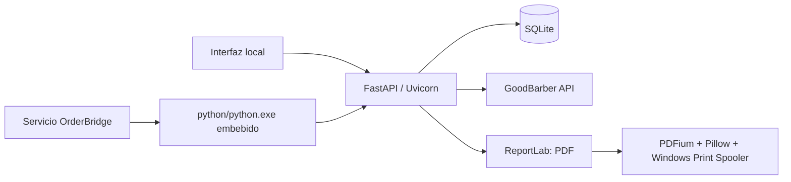

# OrderBridge Python: guía técnica del proyecto

Revisión de la copia de trabajo: 16 de noviembre de 2026.

## Resumen

OrderBridge es una aplicación local para recibir o consultar pedidos de GoodBarber, guardarlos en SQLite, mostrarlos en una interfaz web local y generar/imprimir comprobantes en una impresora de Windows.

El despliegue actual incluye una distribución de CPython para Windows dentro de `python/`, junto con las dependencias de la aplicación. El arranque normal usa ese intérprete. No crea un entorno virtual global, no ejecuta `py -3`, no modifica `PATH` y no instala Python en Windows.

La instalación como servicio sí cambia la configuración de Windows: registra el servicio `OrderBridge` para que arranque automáticamente y reinicie ante ciertos fallos. También copia los componentes requeridos por pywin32 dentro de la carpeta local `python/`. Esos cambios pertenecen al servicio y al proyecto; no son una instalación de Python en el sistema.

## Arquitectura



### Componentes

| Ruta | Responsabilidad |
|---|---|
| `app/main.py` | Crea la API, prepara las tablas, monta la interfaz y arranca la sincronización programada. |
| `app/api/` | Rutas HTTP para pedidos, impresoras, salud y sincronización. |
| `app/services/goodbarber.py` | Consulta pedidos a GoodBarber mediante HTTPS y el token configurado. |
| `app/services/order_mapper.py` | Convierte el formato remoto a los campos internos y ajusta fechas a la zona local configurada. |
| `app/services/sync_service.py` | Inserta/actualiza pedidos, conserva ciertos estados locales y gestiona la impresión al sincronizar. |
| `app/db/` | Modelos SQLAlchemy y conexión a SQLite. |
| `app/services/pdf_service.py` | Diseña el comprobante tamaño Letter. |
| `app/services/print_service.py` | Renderiza cada página del PDF como imagen y la envía a la cola de impresión de Windows. |
| `frontend/` | Panel web servido por la misma API; permite sincronizar, seleccionar impresora, probarla y reimprimir pedidos. |
| `python/` | Python 3.13.14 para Windows x64 y paquetes instalados dentro de la distribución local. |
| `windows_service.py` | Servicio Windows que inicia y supervisa Uvicorn como proceso hijo. |
| `*_service.bat`, `run_embedded.bat` | Instalación, control y ejecución local del servicio o la aplicación. |
| `legacy_service/` | Scripts de la instalación antigua basada en `.venv`; no se usan en el despliegue embebido actual. |

## Python embebido y cambios en el equipo

En esta copia se verificó que `python/python.exe` es CPython 3.13.14, que `sys.executable` apunta dentro del proyecto y que `sys.path` carga la biblioteca estándar y `site-packages` desde `python/`. Las dependencias principales —FastAPI, Uvicorn, SQLAlchemy, pywin32, ReportLab, Pillow y pypdfium2— están incluidas allí.

El flujo actual funciona sin un Python instalado en la máquina de destino:

1. Copiar la carpeta completa del proyecto, incluido `python/`.
2. Crear `.env` a partir de `.env.example` y configurar GoodBarber.
3. Usar `run_embedded.bat` para ejecución manual, o instalar el servicio con `install_service.bat`.

`install_service.bat` requiere una consola elevada. Usa `python/python.exe`, copia `pythonservice.exe` y las DLL de pywin32 que necesita al directorio local `python/`, registra el servicio Windows `OrderBridge`, configura inicio automático y recuperación ante fallos, y lo inicia. No ejecuta `pip install`, no busca el Python del sistema ni cambia `PATH`.

`uninstall_service.bat` quita el servicio, pero conserva el proyecto y sus datos. Si se mueve la carpeta después de instalar el servicio, hay que desinstalarlo y volverlo a instalar porque la ruta queda registrada en Windows. El instalador no configura una cuenta de servicio personalizada; una impresora o recurso visible solo para la sesión interactiva podría no estar disponible para el servicio.

Los archivos bajo `legacy_service/` son históricos. En particular, sus scripts usan `py -3`, crean `.venv` y ejecutan `pip`; no deben usarse para instalar esta versión embebida.

## Puesta en marcha

### Configurar

```powershell
Copy-Item .env.example .env
```

Editar `.env` y completar al menos `GOODBARBER_APP_ID` y `GOODBARBER_API_KEY`. El archivo `.env` contiene secretos y está excluido de Git. La impresora debe estar instalada en Windows y disponible para la identidad que ejecute la aplicación.

### Ejecución manual

```bat
run_embedded.bat
```

La aplicación queda en `http://127.0.0.1:8000`; salud: `http://127.0.0.1:8000/api/health`.

### Servicio Windows

En PowerShell o CMD como administrador:

```powershell
.\install_service.bat
```

Comandos posteriores: `service_status.bat`, `start_service.bat`, `stop_service.bat` y `restart_service.bat`. Para quitarlo: `uninstall_service.bat`.

## Configuración

Los valores se leen desde `.env` usando `app/config.py`. Los valores de la tabla son los predeterminados del código o de `.env.example`.

| Variable | Uso |
|---|---|
| `APP_NAME` | Nombre del servicio en la respuesta de salud. |
| `API_HOST`, `API_PORT` | Dirección y puerto de Uvicorn. El servicio Windows los respeta; `run_embedded.bat` actualmente fija `127.0.0.1:8000`. |
| `DATABASE_URL` | Base SQLAlchemy; por defecto `sqlite:///./storage/orderbridge.db`. |
| `GOODBARBER_APP_ID`, `GOODBARBER_API_KEY` | Identificador y credencial para la API de GoodBarber. La clave se envía como encabezado `token`. |
| `GOODBARBER_BASE_URL`, `GOODBARBER_ORDERS_PATH` | Host y ruta de consulta. La ruta admite `{webzine_id}` y `{app_id}`. |
| `GOODBARBER_PER_PAGE`, `GOODBARBER_TIMEOUT_SECONDS` | Tamaño de página solicitado y tiempo de espera HTTP. |
| `GOODBARBER_SYNC_ENABLED`, `GOODBARBER_SYNC_INTERVAL_SECONDS` | Activa la sincronización automática y fija su intervalo en segundos. |
| `AUTO_PRINT_NEW_ORDERS` | Controla la impresión automática de pedidos que el sincronizador ve con estado `new`. |
| `LOCAL_TIMEZONE` | Zona usada para convertir fechas con zona horaria; predeterminado `America/Caracas`. |
| `PRINTER_NAME` | Impresora preferida si no hay una selección guardada que siga disponible. |
| `PRINT_PDF_DIR` | Directorio de PDFs generados; predeterminado `storage/print_pdfs`. |
| `MERCHANT_NAME`, `MERCHANT_ADDRESS_LINE1`, `MERCHANT_ADDRESS_LINE2`, `MERCHANT_COUNTRY`, `MERCHANT_PHONE`, `MERCHANT_EMAIL` | Datos del comercio usados como respaldo en el comprobante cuando el pedido no contiene los datos del vendedor. |

`WINDOWS_PRINT_ACTION` y `SUMATRA_PDF_PATH` aparecen en `.env.example`, pero no se leen en el código activo. La impresión actual usa pywin32, PDFium y Pillow; no necesita Sumatra PDF.

## Sincronización y pedidos

La sincronización puede iniciarse desde el panel o con `POST /api/sync/goodbarber`. Si `GOODBARBER_SYNC_ENABLED=true`, al arrancar la aplicación se programa además una sincronización inicial y se repite cada `GOODBARBER_SYNC_INTERVAL_SECONDS`.

El identificador remoto es la clave del pedido. El sincronizador actualiza los datos y reemplaza las líneas de productos; conserva los estados locales `printing`, `printed`, `print_failed`, `done` y `cancelled`. GoodBarber `CANCELLED` se mapea a `cancelled`; `DELIVERED` y `FULFILLED` se mapean a `done`; otros estados quedan como `new` antes de aplicar la conservación local.

Los modelos de SQLite son:

- `orders`: pedido, cliente, pagos, entrega, importes, estado y `raw_payload` JSON.
- `order_items`: productos asociados, ordenados por posición.
- `app_settings`: selección local de impresora.

Al inicio se llama a `Base.metadata.create_all()`. Esto crea tablas faltantes, pero no es un sistema de migraciones para alterar tablas existentes cuando cambie el esquema.

### Impresión

Los comprobantes se generan en tamaño Letter. El código rasteriza cada página a 216 DPI, la ajusta al área imprimible de la impresora y la envía a Windows. La prioridad para elegir impresora es: selección guardada desde el panel, `PRINTER_NAME`, impresora predeterminada de Windows.

El webhook y la acción de reimpresión marcan el pedido `printing` y luego `printed`; ante error lo marcan `print_failed`. El endpoint de PDF genera un archivo temporal de la aplicación y lo elimina después de enviarlo al cliente. No es un archivo de archivo permanente.

## API HTTP

La interfaz web y la API usan el mismo origen. Rutas principales:

| Método y ruta | Función |
|---|---|
| `GET /api/health` | Estado básico de la aplicación. |
| `GET /api/orders` | Lista todos los pedidos, opcionalmente filtrados por `?status=`. |
| `GET /api/orders/{order_id}` | Devuelve un pedido. |
| `GET /api/orders/{order_id}/pdf` | Genera y descarga el comprobante PDF. |
| `POST /api/orders/{order_id}/print` | Reimprime un pedido guardado. |
| `PATCH /api/orders/{order_id}/status` | Cambia el estado a `new`, `printing`, `printed`, `print_failed`, `done` o `cancelled`. |
| `GET /api/orders/printers` | Lista impresoras locales y la selección activa. |
| `POST /api/orders/printers/select` | Valida y guarda `printer_name`. |
| `POST /api/orders/printers/test` | Imprime una página de prueba. |
| `POST /api/orders/webhook/goodbarber` | Recibe un pedido en el cuerpo JSON y trata de guardarlo e imprimirlo. |
| `POST /api/sync/goodbarber` | Consulta GoodBarber y sincroniza pedidos. |

## Seguridad y datos locales

La aplicación no implementa autenticación en estas rutas. Por defecto escucha en `127.0.0.1`; mantener ese valor limita el acceso a la máquina local. Si se cambia `API_HOST` para escuchar en una interfaz de red, el panel, los datos de clientes y las acciones de impresión quedan accesibles sin autenticación. El webhook tampoco verifica una firma entrante. No se debe exponer directamente a Internet.

`raw_payload` conserva el pedido recibido, que puede incluir datos personales. La base SQLite y los PDFs están dentro de `storage/`; proteger la carpeta y hacer copias de seguridad acordes con esos datos. `.env` contiene la credencial de GoodBarber y no debe publicarse.

`.gitignore` excluye `.env`, logs, la base SQLite, los PDFs generados y `storage/settings.json`. Este último archivo guarda la selección de impresora de la máquina y no forma parte del código publicado.

## Logs y diagnóstico

- `logs/orderbridge.log`: logging de la aplicación; rota al llegar a 1.5 MB y conserva cinco archivos.
- `logs/service-boot.log`: eventos de arranque y parada del servicio.
- `logs/service-stdout.log` y `logs/service-stderr.log`: salida del proceso Uvicorn administrado por el servicio.
- `logs/embedded_service.log`: salida de `run_embedded.bat`.
- `logs/uvicorn.out.log` y `logs/uvicorn.err.log`: nombres de la instalación histórica.

Los archivos de arranque y salida del servicio se abren en modo append y no tienen rotación en el código actual. Revisar el espacio en disco y limpiar/rotar esos logs periódicamente. Una falla de impresión suele dejar detalle en `orderbridge.log` y `service-stderr.log`.

## Hallazgos de revisión

1. **El flujo normal es embebido; el servicio modifica Windows, no la instalación de Python.** Requiere permisos de administrador para registrar/eliminar el servicio y escribe los binarios auxiliares en la carpeta local `python/`.
2. **La instalación antigua es distinta.** `legacy_service/` crea `.venv` con el Python del lanzador `py` e instala paquetes con pip; no utilizar esos scripts para el flujo embebido.
3. **El arranque manual ignora `API_HOST` y `API_PORT`.** `run_embedded.bat` fija `127.0.0.1:8000`, mientras que el servicio Windows toma ambos valores de `.env`.
4. **Un error de autoimpresión en la sincronización deja el pedido en `new`.** Con la impresión automática activa, una sincronización posterior puede intentar imprimirlo de nuevo. El webhook y la reimpresión sí registran `print_failed`.
5. **Los logs del servicio no rotan.** La aplicación rota `orderbridge.log`, pero `service-stdout.log`, `service-stderr.log`, `service-boot.log` y `embedded_service.log` pueden crecer sin límite.
6. **Mantener dependencias sincronizadas.** `requirements.txt` ahora fija `tzdata==2026.2`, igual que la distribución embebida; actualizar ambos al reconstruir el runtime.
7. **No hay migraciones de base de datos.** `create_all()` no modifica tablas ya existentes; respaldar la base antes de cambios de esquema.
8. **No publicar datos locales.** La regla para excluir `storage/settings.json` se añadió al preparar la publicación del proyecto; la base de pedidos, los PDFs y los logs locales tampoco se incluyen.

## Reproducibilidad

`requirements.txt` documenta las versiones directas de las dependencias, mientras que la carpeta `python/` contiene el runtime ya preparado y dependencias transitivas. Para entregar una copia funcional sin Python instalado, distribuir la carpeta completa, no solo `app/` y `frontend/`. La carpeta debe corresponder a Windows x64. La licencia del runtime está en `python/LICENSE.txt` y las licencias de paquetes se distribuyen en sus metadatos dentro de `python/Lib/site-packages/`.
